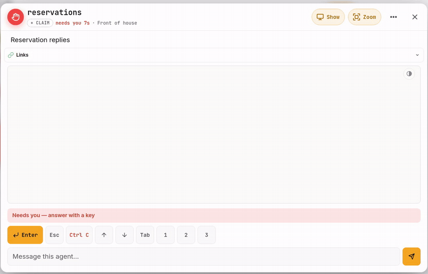

# ORCA



Un panel de control gratuito y autoalojado para los agentes de IA que corres en tu propia
computadora (Claude Code, Codex, Gemini, opencode, modelos locales y otros), con **rutinas** programadas cuyos
borradores esperan tu aprobación. Por [Operio](https://make.operio.work). Licencia MIT.

ORCA significa **Orquesta, Responde, Controla, Aprueba**.

[English](README.md)

- Ve a cada agente en un mapa en vivo: trabajando, inactivo, terminado o esperándote.
- Lee lo que escribe un agente, respóndele, contesta sus preguntas con un toque, inicia agentes nuevos.
- Alertas en el teléfono (web push, opcional) cuando un agente termina o te necesita.
- Rutinas: un agente arranca en un horario con una tarea fija y escribe un borrador o reporte.
  Nunca se envía, publica ni manda por correo nada por ti.
- Agentes guardados (instrucciones, habilidades, herramientas), equipos con un líder y
  trabajadores que hacen una tarea, reportan y se cierran solos.
- Herramientas MCP por agente con secretos que no se vuelven a mostrar, varias cuentas por tipo de
  agente, y el panel en inglés, español, francés, portugués o italiano.

ORCA **funciona sobre [herdr](https://github.com/herdrdev/herdr)**, el espacio de trabajo
en terminal para agentes de IA de Can Celik y colaboradores (Apache-2.0). herdr no es nuestro:
el instalador descarga su versión oficial y la verifica. Ver `THIRD_PARTY_NOTICES.md`.

## Instalación

Linux (x86_64, arm64) o macOS (Apple silicon, Intel), Node.js 20 o más nuevo. Sin sudo, sin Docker.

```bash
curl -fsSL https://make.operio.work/install.sh | bash
```

O desde una copia del repositorio: `git clone https://github.com/operio-work/orca && cd orca && bash install.sh`.

El instalador:

- descarga herdr **0.9.5** para tu plataforma y la versión publicada del panel de ORCA, y
  verifica las dos contra las sumas sha256 del script (si no coinciden, no instala nada);
- instala el panel en `~/.local/share/operio-orca` y `operio-orca` en `~/.local/bin`;
- instala un servicio de usuario de systemd (Linux) o un agente de launchd (macOS) y lo inicia
  (`--no-service` escribe los archivos sin activarlos);
- apaga las revisiones de actualización en segundo plano de herdr en
  `~/.config/herdr/config.toml` (un bloque marcado que se quita al desinstalar). herdr queda
  fijado: usa `operio-orca update`, no `herdr update`, para que herdr y el panel se muevan juntos.

Puedes correrlo de nuevo sin problema. Luego abre **http://127.0.0.1:7171**.

```
operio-orca start | stop | restart | status | open | doctor | logs | update | backup | restore | llm | uninstall
```

¿Por qué `operio-orca` y no `orca`? Ubuntu y muchos escritorios Linux ya traen `/usr/bin/orca`,
el lector de pantalla de GNOME. Un nombre distinto evita que se confundan.

## Úsalo desde tu teléfono

ORCA solo escucha en `127.0.0.1`. Déjalo así y llega a él por una de estas vías:

- **Tailscale** (red privada, HTTPS): `tailscale serve --bg 7171`, luego pon el nombre que
  muestra en `~/.config/operio-orca/env` como `OPERIO_ORCA_ALLOWED_HOSTS=<equipo>.<tailnet>.ts.net`
  y corre `operio-orca restart`. Las alertas push necesitan HTTPS, así que esta es la vía para tenerlas.
- **Túnel SSH**: `ssh -N -L 7171:127.0.0.1:7171 tu@esta-computadora`, luego abre
  `http://127.0.0.1:7171` en el dispositivo donde corre el túnel.

Nunca lo expongas a internet: sin reenvío de puertos, sin Tailscale Funnel.

## Modelo de seguridad

ORCA puede escribir en tus agentes y abrir terminales **con tu usuario**. No hay inicio de
sesión. Lo que lo protege es que solo tú puedes llegar a él:

- Escucha en `127.0.0.1`. `OPERIO_ORCA_HOST` lo cambia; el servidor muestra entonces una
  advertencia clara, y no deberías hacerlo en una red en la que no confíes por completo.
- Solo responde a `localhost`, `127.0.0.1`, `[::1]` y a los nombres de
  `OPERIO_ORCA_ALLOWED_HOSTS`; cualquier otro `Host` recibe `421`. Esto bloquea ataques de DNS rebinding.
- Toda petición que cambia algo necesita un encabezado `Origin` del mismo origen, lo que
  impide que otros sitios web le envíen peticiones (CSRF).
- Abrir o crear una terminal pide una confirmación primero, que dura 15 minutos.
- Ajustes, claves de API (`llm.env`), llaves VAPID, estado y registros viven en
  `~/.config/operio-orca` con permisos solo para ti. Las instrucciones y respuestas de los agentes
  nunca se escriben en el registro. La Bitácora guarda lo que enviaste y lo que respondieron los
  agentes durante 90 días, con llaves y tokens ocultos antes de escribir nada.

Cualquiera con acceso a tu cuenta de usuario, o a un dispositivo desde el que abras el túnel, puede usarlo.

## Rutinas

Un paquete de rutina es una carpeta con un `routine.json` en `~/.config/operio-orca/routines/<id>/`
(el formato está en el [README en inglés](README.md#routines)).

- `schedule` es una línea cron de 5 campos en la hora local de la computadora. El programador
  corre dentro de ORCA; nunca se toca el crontab del sistema. Las ejecuciones perdidas
  mientras estaba detenido se saltan. En la pestaña **Rutinas** lo cambias con palabras simples
  (todos los días, lun–vie, lun–sáb, un día a la semana o cada hora, a una hora); la línea cron
  queda en **Avanzado** para todo lo demás.
  Si omites `schedule`, la rutina es **bajo pedido**: la pestaña la muestra como "Bajo pedido" y
  solo corre cuando pulsas **Ejecutar ahora**.
- Las rutinas con `approval: "draft"` escriben en `~/.config/operio-orca/drafts/<id>/`, y el
  borrador espera en la pestaña **Rutinas** hasta que lo apruebes o rechaces. Aprobar solo lo
  marca como aprobado. Las de `"none"` escriben un reporte en `~/.config/operio-orca/reports/<id>/`.
- `agent` es `claude`, `codex` u `opencode` (instalado y con sesión iniciada por ti).
- Cada ejecución abre un panel de agente en herdr, así que puedes verlo, responder sus
  preguntas (por ejemplo, permiso para escribir el archivo) o detenerlo como a cualquier agente.
- Cada ejecución queda registrada como líneas JSON (entrada, ruta de salida, estado) en
  `~/.config/operio-orca/logs/routines.jsonl`.

Se incluyen cinco paquetes apagados. Leen los archivos que dejes en `~/orca-desk/` y nunca
le envían nada a tus clientes: hacen un reporte, o preparan un borrador y tú lo envías.

| Paquete | Se ejecuta | Resultado |
|---|---|---|
| Resumen matutino de recepción | lun–sáb 07:30 | reporte |
| Respuestas a reseñas | todos los días 09:00 | borradores de respuesta, tú los publicas |
| Reporte semanal para el dueño | lunes 08:00 | reporte |
| Paquete para día de visitas (inmobiliarias) | bajo pedido | reporte: ruta, fichas de propiedades, lista |
| Agradecimiento después de la visita + reseña | todos los días 18:00 | borradores con un enlace de WhatsApp que tocas para enviar |

La lista completa, con las rutinas que Operio opera por ti, está en `catalog/catalog.json`.

## Detener, Terminar y la Bitácora

- **Detener** (en la tarjeta de un agente que está trabajando) interrumpe el trabajo; el agente
  sigue. Envía Esc, y un ⌃C a Claude si sigue trabajando. opencode solo recibe Esc, porque ⌃C lo cierra.
- **Terminar agente** (en el panel ⋯ de la tarjeta) primero muestra qué se perdería: cambios sin
  commit en su carpeta, un worktree, enlaces con otros agentes, el último panel de un espacio.
  Luego guarda su última salida, le pide que salga con su propio comando (`/exit`, `/quit`) y
  cierra su panel. Su carpeta, archivos y worktree nunca se tocan.
- La **Bitácora** (ícono de libro en el encabezado) es una cronología de lo que hicieron tú y tus
  agentes: agentes iniciados y terminados, mensajes, respuestas, trabajos terminados con su
  salida guardada, enlaces y confirmaciones de terminal. Fíltrala, búscala, exporta un día en
  Markdown. La pestaña **Revisión diaria** resume cada día terminado para que lo marques como
  revisado con una nota; el ícono muestra cuántos días esperan. El panel ⋯ de la tarjeta tiene el
  mismo historial para un agente.
- Son archivos simples en `~/.config/operio-orca/journal/` (solo para ti): una línea JSON por
  entrada, con llaves y tokens ocultos antes de escribirse. Los días de más de 7 se comprimen y los
  de más de 90 se borran. No se envía nada a ningún lado ni se llama a ningún modelo; la revisión
  es un resumen que ORCA arma con las entradas.

## Agentes guardados, equipos y trabajadores

- **Agentes guardados** (Administración → Agentes y cuentas, o el botón Agentes guardados): un
  agente que configuras una vez — instrucciones, habilidades, herramientas integradas (todas / sin
  edición / solo lectura), herramientas MCP y la cuenta con la que corre. **Arráncalo** cuando
  quieras; **Retomar** sigue la última conversación de un agente Claude. Una copia activa por
  agente guardado. Los archivos de cada arranque viven en `~/.config/operio-orca/runs/<nombre>` (0600).
- **Equipos**: un agente guardado puede *reportar a* un líder (máximo dos niveles: un líder no le
  reporta a nadie). Cuando ambos corren, ORCA los enlaza; el trabajo terminado de un miembro se le
  ofrece al líder. Los agentes ven su equipo con `orca-send --team`.
- **Trabajadores**: una configuración de tipo *trabajador* arranca con una tarea, manda su respuesta
  final a su líder (o a ti) y se cierra sola, o se detiene al llegar a su tiempo máximo. Un líder
  pide uno con `orca-send --spawn <configuración> "tarea"`; tú lo apruebas primero. Máximo seis a la vez.
- **Herramientas (MCP)**: Administración → Herramientas registra servidores MCP (un comando local o
  una URL HTTPS). Escribe `${NOMBRE}` donde va una clave y guarda NOMBRE en Secretos: los valores
  quedan en un archivo 0600 y no se vuelven a mostrar, y cada agente Claude recibe solo sus
  servidores y sus secretos. Un servidor que agregues corre con tus permisos en esta computadora:
  agrega solo los de confianza.
- **Cuentas**: varias cuentas por tipo de agente — Claude y Codex en sus propias carpetas de
  configuración, y claves de API de Google para Gemini y Antigravity.
- **Modelos locales**: el agente *Local (Ollama)* corre un modelo de Ollama que usa herramientas, a
  través de opencode. Es lento en GPUs pequeñas.

## Ajustes

`~/.config/operio-orca/env`, un `CLAVE=valor` por línea: `OPERIO_ORCA_PORT` (7171),
`OPERIO_ORCA_HOST` (127.0.0.1), `OPERIO_ORCA_ALLOWED_HOSTS`, `OPERIO_ORCA_FOLDERS` (carpetas que se
ofrecen para agentes nuevos, por defecto `~`), `OPERIO_ORCA_SHELL_CONFIRM_MIN` (15),
`OPERIO_ORCA_JOURNAL_DAYS` (90).

## Claves LLM y suscripciones

Cada agente necesita un modelo. Los cuatro que ORCA conoce (Claude Code, Codex, opencode, Gemini
CLI) aceptan una **suscripción** o una **clave de API**:

- **Suscripción**: inicia sesión una vez, en la terminal del propio agente en esta computadora
  (`claude` y luego `/login`; `codex login`; `opencode auth login`; `gemini` y elige su inicio de
  sesión). El agente guarda esa sesión por su cuenta; ORCA no almacena nada.
- **Clave de API**: `operio-orca llm set ANTHROPIC_API_KEY`. El valor se escribe en un aviso oculto
  o llega por tubería (`printf '%s' "$KEY" | operio-orca llm set OPENAI_API_KEY`); nunca va como
  argumento, así que no queda en el historial de tu shell. Usa el nombre que lee el agente:
  `ANTHROPIC_API_KEY`, `OPENAI_API_KEY`, `OPENAI_BASE_URL`, `GEMINI_API_KEY` o cualquier otro.

Las claves viven en `~/.config/operio-orca/llm.env`, un `NOMBRE=valor` por línea, modo 600. Todas
las formas de arrancar herdr cargan ese archivo en su entorno (las unidades de systemd con
`EnvironmentFile=`, los agentes de launchd, `operio-orca start`), y los agentes corren dentro de
herdr, así que todos la ven.

- `operio-orca llm list`: los nombres guardados, cada uno con sus últimos 4 caracteres.
  `llm unset NOMBRE` quita uno.
- `operio-orca llm apply`: reinicia herdr para que un herdr en marcha tome las claves. Reiniciar
  cierra todos los paneles de agentes, así que se niega, diciendo cuáles, mientras alguno esté
  trabajando o esperándote; los inactivos se cierran y los vuelves a iniciar. Sin servicio
  (arrancado a mano) reinicia el herdr que ORCA arrancó; uno que arrancaste tú se deja en paz y te
  lo dice.
- `operio-orca llm test claude|codex|opencode|gemini`: corre ese agente una vez, en una carpeta
  vacía, con las claves cargadas y una instrucción mínima; imprime `ok` o `failed: <última línea
  de error>`, nunca la clave. `not installed: <tipo>` si falta el CLI.
- `operio-orca doctor` muestra el modo del archivo y los nombres guardados. El panel tiene lo
  mismo bajo el icono de llave en la cabecera (agregar, quitar, Aplicar). La Bitácora oculta los
  valores de las claves por nombre y por forma.

Instalaciones existentes: `operio-orca update` (o correr el instalador de nuevo) reescribe los
archivos de servicio con la línea `EnvironmentFile=`.

## Demo

`operio-orca demo` inicia un segundo panel en **http://127.0.0.1:7172** con dos negocios
ficticios, Harbor Street Bistro y Brightside Dental, que cambias arriba. Sus agentes siguen un
guion: cada uno trabaja, se detiene a preguntarte algo (responde con un toque o un mensaje y
las siguientes líneas cambian según tu respuesta), termina y vuelve a empezar. Sin gasto de API,
sin datos reales, y nunca toca herdr, tus agentes ni `~/.config/operio-orca` (vive en
`~/.config/operio-orca-demo`). La pestaña Rutinas trae paquetes de ejemplo, historial y un
borrador por aprobar para cada negocio.

```
operio-orca demo              iniciarlo (los agentes empiezan desde el principio)
operio-orca demo --reset      empezar de cero: también rutinas, borradores e historial
operio-orca demo --speed 2    reproducir el guion al doble de velocidad
operio-orca demo --lang es    la demo en español (agentes, rutinas y borradores; se queda hasta que la cambies)
operio-orca demo --stop       detenerlo
```

Hay capturas en `demo/screenshots/` (en español: `demo/screenshots/es/`).

## Desinstalar

`operio-orca uninstall` (agrega `--purge` para borrar también `~/.config/operio-orca`). Nunca
detiene tu servidor de herdr ni tus agentes.

## ¿Prefieres que lo operen por ti?

ORCA es la versión gratuita para hacerlo tú mismo. Si prefieres que Operio lo opere por ti,
**ORCA Gestionado por Operio** opera tu equipo de operaciones con IA (WhatsApp, Perfil de Negocio de Google, rutinas bilingües, aprobaciones y
monitoreo), visita [make.operio.work](https://make.operio.work).

ORCA Gestionado también incluye un **chat del equipo**: comentarios en cada agente, una sala
para todo el equipo, alertas cuando alguien te menciona y agentes dentro de la conversación
(escribe `@opiniones acorta la introducción` y la respuesta vuelve al hilo). Los mensajes se
pueden traducir entre español e inglés. Para verlo en la demo:
`OPERIO_ORCA_HOSTED=1 operio-orca demo --reset --lang es`.

## Licencia

MIT, Copyright (c) 2026 Operio. herdr y los demás componentes conservan sus propias licencias;
ver `THIRD_PARTY_NOTICES.md`.
