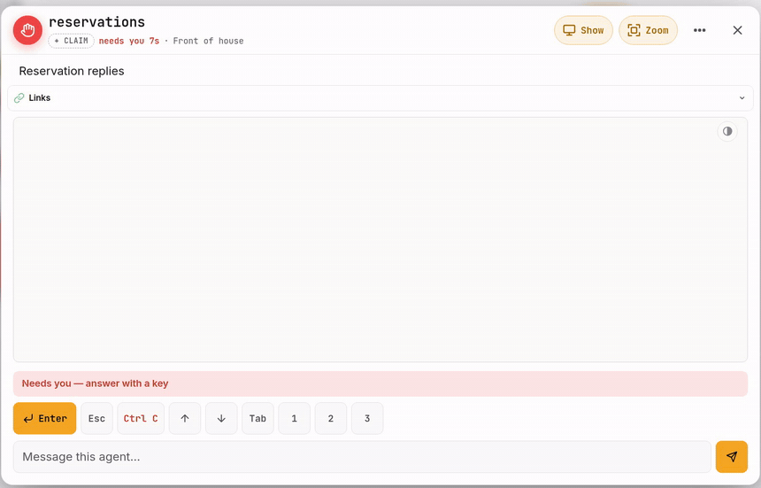

# ORCA



A free, self-hosted control panel for the AI coding agents you run on your own computer
(Claude Code, Codex, opencode and others), plus scheduled **routines** whose drafts wait for
your approval. By [Operio](https://make.operio.work). MIT licensed.

ORCA stands for **Orchestrate, Reply, Check, Approve**.

[Español](README.es.md)

- See every agent as a live map: working, idle, done, or waiting on you.
- Read an agent's output, reply to it, answer its questions with one tap, start new agents.
- Phone alerts (optional web push) when an agent finishes or needs you.
- Routines: an agent starts on a schedule with a fixed task and writes a draft or report.
  Nothing is ever sent, posted or emailed for you.

ORCA **runs on [herdr](https://github.com/herdrdev/herdr)**, the terminal workspace for AI
agents by Can Celik and contributors (Apache-2.0). herdr is not ours: the installer downloads
its official release and checks it. See `THIRD_PARTY_NOTICES.md`.

## Install

Linux (x86_64, arm64) or macOS (Apple silicon, Intel), Node.js 20 or newer. No sudo, no Docker.

```bash
curl -fsSL https://make.operio.work/install.sh | bash
```

Or from a checkout: `git clone https://github.com/operio-work/orca && cd orca && bash install.sh`.

The installer:

- downloads herdr **0.9.5** for your platform and the ORCA panel release, and verifies both
  against sha256 sums in the script (nothing is installed on a mismatch);
- installs the panel to `~/.local/share/operio-orca` and `operio-orca` to `~/.local/bin`;
- installs a systemd user service (Linux) or a launchd agent (macOS) and starts it
  (`--no-service` writes the files without enabling them);
- turns off herdr's background update checks in `~/.config/herdr/config.toml` (a marked block
  it removes again on uninstall). herdr is pinned: use `operio-orca update`, not `herdr update`,
  so herdr and the panel always move together.

It is safe to run again. Then open **http://127.0.0.1:7171**.

```
operio-orca start | stop | restart | status | update | uninstall
```

Why `operio-orca` and not `orca`? Ubuntu and many Linux desktops already ship `/usr/bin/orca`,
the GNOME screen reader. A distinct name keeps the two apart.

## Use it from your phone

ORCA listens on `127.0.0.1` only. Keep it that way and reach it through one of these:

- **Tailscale** (private network, HTTPS): `tailscale serve --bg 7171`, then put the name it
  prints in `~/.config/operio-orca/env` as `OPERIO_ORCA_ALLOWED_HOSTS=<machine>.<tailnet>.ts.net`
  and run `operio-orca restart`. Web push alerts need HTTPS, so this is the way to get them.
- **SSH tunnel**: `ssh -N -L 7171:127.0.0.1:7171 you@this-computer`, then open
  `http://127.0.0.1:7171` on the device the tunnel runs on.

Never expose it to the internet: no port forwarding, no Tailscale Funnel.

## Security model

ORCA can type into your agents and open shells **as you**. There is no login. What keeps
it safe is that only you can reach it:

- It binds to `127.0.0.1`. `OPERIO_ORCA_HOST` changes that; the server then prints a loud
  warning, and you should not do it on a network you don't fully trust.
- It answers only to `localhost`, `127.0.0.1`, `[::1]` and the names in
  `OPERIO_ORCA_ALLOWED_HOSTS`; any other `Host` gets `421`. This blocks DNS-rebinding attacks.
- Every request that changes something needs a same-origin `Origin` header, which blocks
  other websites from posting to it (CSRF).
- Opening or creating a shell asks for a confirmation first, which lasts 15 minutes.
- Settings, VAPID keys, state and logs live in `~/.config/operio-orca` with owner-only permissions.
  Agent prompts and replies are never written to the log.

Anyone with access to your user account, or to a device you tunnel from, can use it.

## Routines

A routine pack is a folder with a `routine.json` in `~/.config/operio-orca/routines/<id>/`:

```json
{
  "id": "review-reply-desk",
  "name": { "en": "Review Reply Desk", "es": "Respuestas a reseñas" },
  "problem": { "en": "Reviews sit unanswered…", "es": "Las reseñas se quedan sin respuesta…" },
  "prompt": "What the agent should do…",
  "schedule": "0 9 * * *",
  "approval": "draft",
  "agent": "claude",
  "cwd": "~"
}
```

- `schedule` is a 5-field cron line in the computer's local time. The scheduler runs inside
  ORCA; your system crontab is never touched. Runs missed while it was stopped are skipped.
  In the **Routines** tab you change it in plain words (every day, Mon–Fri, Mon–Sat, one day a
  week or every hour, at a time); the cron line stays under **Advanced** for anything else.
  Leave `schedule` out for an **on-demand** routine: the tab shows it as "On demand" and it runs
  only when you press **Run now**.
- `approval: "draft"` routines write to `~/.config/operio-orca/drafts/<id>/`, and the draft waits
  in the **Routines** tab until you approve or reject it. Approving only marks it approved.
  `"none"` routines write a report to `~/.config/operio-orca/reports/<id>/`.
- `agent` is `claude`, `codex` or `opencode` (installed and signed in by you).
- Each run starts an agent pane in herdr, so you can watch it, answer its questions (for
  example, permission to write the file) or stop it like any other agent.
- Every run is logged as JSON lines (input, output path, state) in `~/.config/operio-orca/logs/routines.jsonl`.

Five packs ship turned off. They read files you drop in `~/orca-desk/` and never send
anything to your customers: they report, or they draft and you send.

| Pack | Runs | Output |
|---|---|---|
| Morning Front Desk Brief | Mon–Sat 07:30 | report |
| Review Reply Desk | every day 09:00 | draft replies, you post them |
| Weekly Owner Report | Monday 08:00 | report |
| Showing Day Pack (real estate) | on demand | report: route, property sheets, checklist |
| Post-Visit Thank-You + Review Ask | every day 18:00 | draft messages with a WhatsApp link you tap to send |

The full list, including the routines Operio runs for you, is in `catalog/catalog.json`.

## Settings

`~/.config/operio-orca/env`, one `KEY=value` per line: `OPERIO_ORCA_PORT` (7171),
`OPERIO_ORCA_HOST` (127.0.0.1), `OPERIO_ORCA_ALLOWED_HOSTS`, `OPERIO_ORCA_FOLDERS` (folders offered
for new agents, default `~`), `OPERIO_ORCA_SHELL_CONFIRM_MIN` (15).

## Demo

`operio-orca demo` starts a second panel on **http://127.0.0.1:7172** with two fictional
businesses, Harbor Street Bistro and Brightside Dental, that you switch between at the top.
Their agents are scripted: each one works, stops to ask you something (answer with a tap or a
reply, and the next lines change with your answer), finishes, and starts again. No API spend,
no real data, and it never touches herdr, your agents or `~/.config/operio-orca` (it lives in
`~/.config/operio-orca-demo`). The Routines tab has example packs, run history and a draft
waiting for approval for each business.

```
operio-orca demo              start it (the agents start from the top)
operio-orca demo --reset      start over: routines, drafts and history too
operio-orca demo --speed 2    play the script twice as fast
operio-orca demo --lang es    play it in Spanish (agents, routines, drafts; stays until changed)
operio-orca demo --stop       stop it
```

Screenshots are in `demo/screenshots/` (Spanish: `demo/screenshots/es/`).

## Uninstall

`operio-orca uninstall` (add `--purge` to also delete `~/.config/operio-orca`). It never stops your
herdr server or your agents.

## Development

```bash
npm install
npm test
OPERIO_ORCA_PORT=7172 node server.js
```

Releases: `scripts/release.sh` builds `dist/operio-orca-<version>.tar.gz` reproducibly from the
`v<version>` tag (or HEAD); pin its sha256 in `install.sh` as `PANEL_SHA256`. The website build
(`site/`) ships that tarball under `/releases/` and fails if the pin does not match. See
`CHANGELOG.md`, `CONTRIBUTING.md` and `SECURITY.md`.

## Want it run for you?

ORCA is the free, do-it-yourself version. If you'd rather have Operio run it for you,
**ORCA Managed by Operio** runs your AI operations team (WhatsApp, Google Business Profile, bilingual routines, approvals and
monitoring), see [make.operio.work](https://make.operio.work).

## License

MIT, Copyright (c) 2026 Operio. herdr and the other components keep their own licenses; see
`THIRD_PARTY_NOTICES.md`.
